# PromptFoundry V2

**Turn a rough idea into a complete, professional prompt—and carry it into Codex without rebuilding the brief by hand.**

PromptFoundry is a native macOS prompt-development workspace for people who know what they want to accomplish but do not want to spend their time manually assembling a long prompt-engineering template. It preserves the user’s intent, adds only useful execution structure, exposes assumptions and missing information, and keeps the finished prompt editable.

It sits between the first thought and the final AI task. Instead of asking users to become prompt engineers, it lets them describe what is on their mind and then helps turn that description into a dependable brief another AI system can understand and execute.

> This is the official source repository. It contains **no developer API key, Codex token, user credentials, personal filesystem paths, prompt history, or private user data**. The ready-to-install DMG is published separately as a GitHub Release asset.

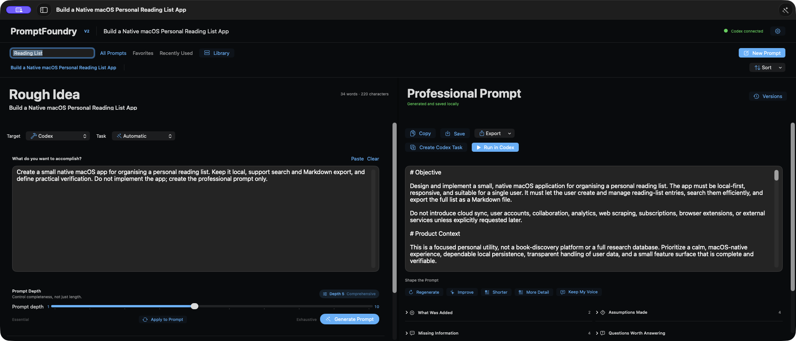

**Version 2.0.0 is available for macOS.** V2 brings a new dark editorial workspace, optional clarification answers, explicit file-content context, safer generation, and version comparison. [Read the changelog](CHANGELOG.md).

## Download and install

Download **[PromptFoundry V2 — macOS DMG](https://github.com/swihpi/PromptFoundry/releases/download/v2.0.0/PromptFoundry-V2-2.0.0-unsigned.dmg)** from the official GitHub release. The app requires an Apple Silicon Mac running macOS 14 or later and a local Codex installation through ChatGPT or the Codex CLI.

| Version | Installer | Release notes |
| --- | --- | --- |
| **V2 · 2.0.0 — current** | [Download V2 DMG](https://github.com/swihpi/PromptFoundry/releases/download/v2.0.0/PromptFoundry-V2-2.0.0-unsigned.dmg) | [V2 release](https://github.com/swihpi/PromptFoundry/releases/tag/v2.0.0) |
| V1 · 1.0.0 — previous | [Download original V1 DMG](https://github.com/swihpi/PromptFoundry/releases/download/v1.0.0/PromptFoundry-1.0.0-unsigned.dmg) | [V1 release](https://github.com/swihpi/PromptFoundry/releases/tag/v1.0.0) |

The V1 release and installer are preserved at their original URLs. V2 installs as **PromptFoundry-V2.app**, so both versions can coexist. On its first launch, V2 copies an existing V1 prompt library into a separate V2 store without saving changes to the V1 store. Later edits are independent; the two libraries do not synchronize. V2 has separate preferences and optional API-key storage, while its default provider uses the user's existing Codex authentication.

1. Open the downloaded DMG.
2. Drag **PromptFoundry-V2** into the **Applications** shortcut shown in the DMG.
3. Open PromptFoundry-V2 from the Applications folder.
4. Complete the five-step setup assistant described below.

### If macOS Gatekeeper blocks the app

This community build is deliberately distributed without an Apple Developer ID signature and is not notarized. It has an ad-hoc local signature for bundle consistency, but macOS may still display a warning such as “Apple could not verify PromptFoundry is free of malware” on first launch. That warning reflects the missing Apple notarization, not a request for an API key or access to your Codex credentials.

Only override Gatekeeper when the DMG came from this repository's official release and its checksum matches the value below:

```text
V2 SHA-256: d9845670734b1573989fd8c853813636ccfa8952f329f08b335beb85b9804b36
V1 SHA-256: 378ac6370cd1e5c902dfc99d1645242269eea14ac53c3f76eccfb773744a84d9
```

The usual one-time opening process is:

1. In Finder, open **Applications**.
2. Control-click (or right-click) **PromptFoundry-V2**, choose **Open**, and then choose **Open** again if macOS offers that confirmation.
3. If macOS still blocks it, open **System Settings → Privacy & Security**.
4. Scroll to the **Security** section, find the message about PromptFoundry-V2, and click **Open Anyway**. On recent macOS versions this may be the required route after the first blocked launch.
5. Authenticate with the Mac user's password or Touch ID if macOS asks, then confirm **Open**.

Do not disable Gatekeeper globally. The per-app **Open** or **Open Anyway** action is the narrow, reversible exception intended for a specific app the user has independently verified.

## What is new in V2

### A workspace designed around reading and writing

The dark editorial interface replaces the old sidebar-heavy composition with horizontal library navigation, recent prompt shortcuts, larger proportional typography, and aligned text editors. The library panel still provides search, tags, favorites, recently used items, sorting, rename, duplication, export, and deletion. Prompt depth sits below the rough idea, and the professional prompt has separate editing, shaping, and handoff actions.

### Answer the gaps before refining again

**Answer & Refine** turns questions and missing information into optional answer fields. Answers are appended to Additional Context and used by **Apply Answers & Improve**, so the next revision is informed by the user's facts rather than guesses. This keeps the quick first-draft workflow while giving users a direct route to a more accurate brief.

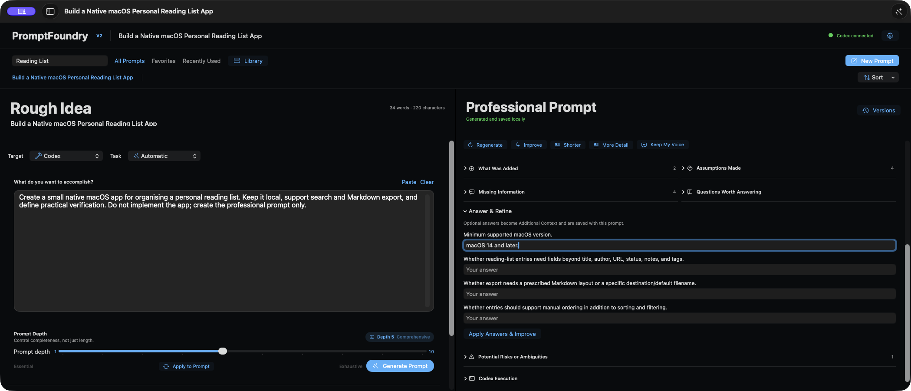

### Decide what a referenced file contributes

Files remain references by default: refinement receives their names, not their contents. Selecting **Use contents** explicitly includes supported UTF-8 text, Markdown, or source-file content in the next refinement request. The current limits are 64 KB per file and 256 KB for combined selected context. Unsupported or oversized files produce an error rather than being silently treated as understood. Content selections reset when switching prompts. The Codex handoff includes referenced file paths in the complete review so users can see exactly what is sent.

### Preserve the last completed result

Generation streams into a temporary preview while the previous completed prompt remains saved. A failure or cancellation preserves that baseline; a successful replacement keeps the previous version. Copy and handoff actions are unavailable during generation to avoid confusing the temporary preview with the completed result.

### Understand a revision before restoring it

The Versions window compares a selected version with the current prompt. Red lines show removed text; blue lines show additions. Users can turn comparison off for a plain preview or restore a previous version, preserving the result they are replacing.

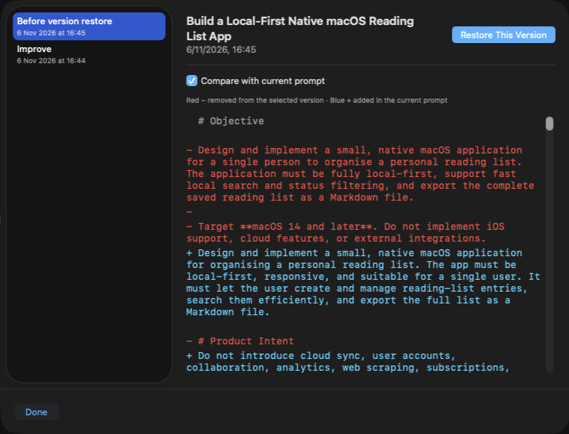

### Review the correct settings for each Codex route

**Run in Codex** sends a prompt and working directory to the desktop app; the model, reasoning, and permissions are selected inside Codex before submission. **Create Codex Task** uses the model, reasoning, and access settings shown in its own review. The interface now separates these routes and describes a desktop handoff as dispatched rather than claiming confirmed creation inside another app.

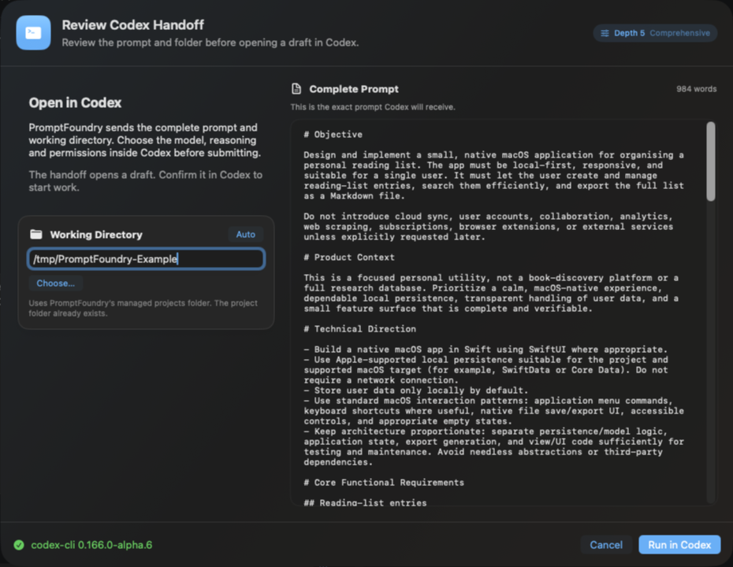

The handoff screenshot uses `/tmp/PromptFoundry-Example` as a generic demonstration path. Each user chooses or automatically creates a project directory on their own Mac.

## First-launch setup

The setup screenshots below document the shared five-step flow retained from V1; the V2 workspace screenshots above show the current interface. Current Codex installations may use a newer executable location than the one shown in the historical setup captures.

PromptFoundry does not ship with somebody else's API key or account. The setup assistant connects the app to the Codex installation and authentication that already belong to the user of the Mac. It also establishes a normal projects folder so Codex handoffs do not interrupt the workflow with an unexplained directory picker.

### 1. Review the local-first privacy model

The welcome step explains the operating boundary before anything is configured: Codex owns authentication, prompt history stays local, and every execution handoff is reviewed before it is sent.

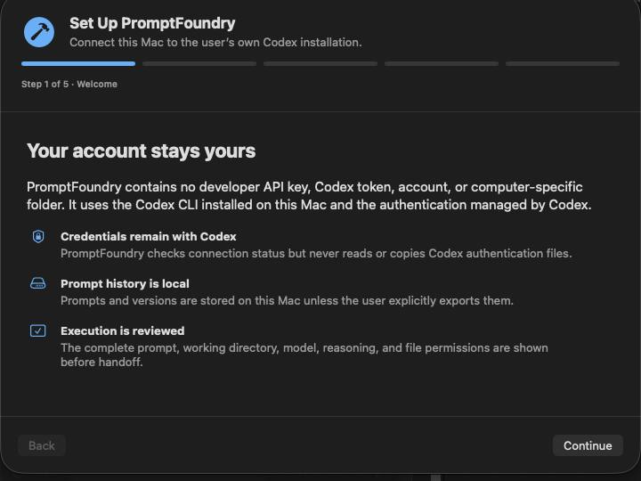

### 2. Locate the Codex CLI

PromptFoundry checks the standard ChatGPT and Codex application locations plus common command-line installation paths. If automatic detection is not suitable, **Locate Codex…** lets the user choose the executable. Only this executable path is saved; PromptFoundry does not import a Codex configuration or credential file.

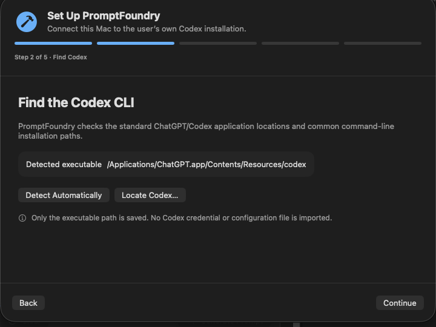

### 3. Verify the user's own Codex connection

The connection check asks the selected CLI whether it is ready. If sign-in is needed, **Start Codex Sign-In** launches the Codex-owned authentication flow. Credentials are entered into and stored by Codex, not by PromptFoundry.

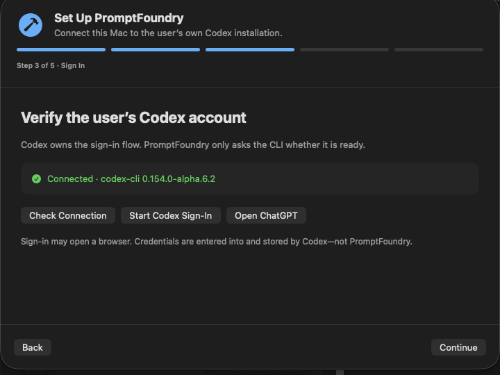

### 4. Choose the projects folder

The default is `~/Documents/PromptFoundry Projects`, or the user can choose an existing folder. This folder is the default workspace for generated Codex tasks; it is not the Codex configuration folder. PromptFoundry still shows the exact working directory in every handoff review.

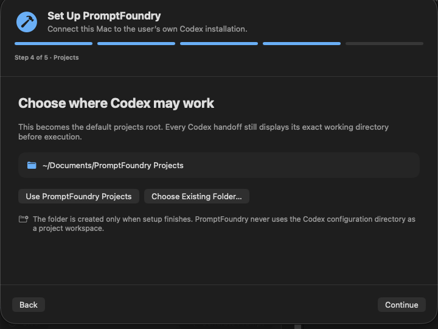

### 5. Confirm the setup

The final step summarizes the executable, connection, projects folder, and local prompt storage before creating the folder and completing setup. Every choice can later be changed in PromptFoundry Settings.

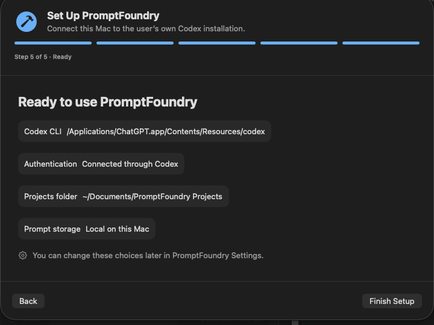

## Why PromptFoundry exists

Most people prompt directly from whatever is in their mind at that moment. That is natural and fast, but it is also easy to omit matters that feel obvious to the author: the real end result, important constraints, existing context, compatibility needs, things that must not change, failure cases, evidence expected at completion, and the difference between a prototype and genuinely finished work.

An AI can only work from the context it receives. When important information is left unstated, it must either guess, produce a generic answer, or stop and ask more questions. The first output may look plausible while missing something essential. The user then discovers the gap later, corrects the prompt, waits for another attempt, and repeats the cycle. Those iterations cost time and can allow an early misunderstanding to propagate into implementation decisions.

PromptFoundry is designed to interrupt that pattern before execution begins. It examines the rough idea as a brief that needs to become actionable, then adds the task-relevant structure a careful professional would normally remember to specify. It can surface scope, deliverables, non-goals, dependencies, ambiguity, risks, validation steps, and a definition of done—without inventing facts that the user never supplied.

This is different from attaching one generic “mega-template” to every request. A research task does not need the same structure as a coding task, a troubleshooting request, or a piece of professional writing. PromptFoundry adapts the prompt to the kind of work being requested and makes missing information visible rather than hiding guesses inside confident prose.

PromptFoundry treats prompt development as an editable workflow:

1. Write naturally in the **Rough Idea** editor.
2. Choose the target and task type—or let the app infer the task type.
3. Set **Prompt Depth** from 1 to 10.
4. Generate a structured professional prompt with a signed-in local Codex account by default.
5. Review additions, assumptions, missing information, questions, and risks.
6. Edit, reshape, save, export, or open the complete prompt in a new Codex chat.

The result is not merely a longer version of the input. It is a clearer execution contract: the intended outcome, relevant constraints, expected deliverables, scope boundaries, verification steps, and honest uncertainty are made explicit where they matter. A stronger first prompt can lead to more accurate outcomes, fewer avoidable revisions, less back-and-forth, and a better chance that the first substantial result is actually useful.

## What it improves over the manual approach

Manual prompting is often optimized for speed at the moment of typing, not for the total time needed to reach a satisfactory result. PromptFoundry adds a short review step upfront so users can catch omissions before an AI commits time to the wrong interpretation. The aim is not to remove human judgment; it is to give that judgment a clearer, more complete object to review.

| Manual prompt preparation | PromptFoundry workflow |
| --- | --- |
| Remember and retype a preferred prompt structure | Applies task-aware structure consistently |
| Important gaps remain hidden inside the final prose | Separates assumptions, missing information, questions, and risks |
| Generic templates add irrelevant boilerplate | Adapts to coding, research, writing, troubleshooting, and other work |
| Revisions overwrite useful earlier wording | Maintains local prompt history and versions |
| Copy, switch apps, choose a folder, and rebuild settings | Reviews the handoff and carries the prompt plus working directory into Codex |
| Prompt length is difficult to calibrate | A 1–10 depth control makes completeness deliberate |

The finished prompt is still the user’s prompt. Every generated result remains editable, the original idea remains visible, and the app explains what it added. Users can accept useful structure, remove irrelevant detail, restore earlier versions, or reshape the result before handing it off.

### Benefits of a professional prompt

A professional prompt improves the quality of the starting conditions. It cannot guarantee that an AI will always produce a perfect answer, but it can reduce preventable failure caused by an incomplete or ambiguous brief. This matters especially for tasks where a polished-looking answer can conceal missing verification, untested behavior, invented assumptions, or scope drift.

- Less ambiguity before work begins.
- Better alignment between the requested outcome and delivered result.
- Fewer unnecessary clarification loops.
- Clearer scope boundaries and non-goals.
- More useful acceptance criteria and verification evidence.
- Explicit treatment of destructive, expensive, external, or irreversible actions.
- A reusable brief that can be edited, versioned, searched, and exported.
- More consistent results across repeated professional workflows.

In practice, this can mean reaching the intended outcome in fewer iterations, spending less time correcting avoidable misunderstandings, and receiving results that are easier to assess because success criteria were defined before the work began. The professional prompt also becomes a durable artifact that can be reused with a colleague, another model, or a later version of the same project.

## The Rough Idea side

The left workspace is deliberately approachable: users can begin with ordinary language instead of learning prompt-engineering syntax. It preserves the speed and freedom of writing a quick thought while offering optional controls when more context is available. A user can enter one sentence and generate immediately, or progressively add files, background, tags, task type, and model preferences.

- **Target** — Codex, ChatGPT, General AI, Writing, Research, Coding, Troubleshooting, or a custom destination.
- **Task type** — select a category or use Automatic so the refiner can adapt the structure.
- **Prompt Depth** — controls completeness from 1 (essential) to 10 (exhaustive), with 5 as the comprehensive default.
- **Rough Idea editor** — a large multiline editor with word and character counts.
- **Additional Context** — optional background, constraints, audience, environment, or desired tone.
- **Files** — references local files, with explicit **Use contents** selection for supported text during refinement.
- **Tags** — organizes prompts for later search and reuse.
- **Refinement Model** — friendly Fast, Balanced, and Deep tiers plus the underlying model and supported reasoning effort.
- **Paste, Clear, and Generate Prompt** — focused controls with keyboard-friendly behavior.

These controls help separate facts the user actually knows from structure the refiner may suggest. Additional Context is the place for project realities and constraints; Files connect the brief to relevant local material; Tags support later reuse; and the target and task type tell the refiner what kind of execution contract will be most useful. None of these controls is required simply to get started.

### Prompt Depth, explained

Prompt Depth controls **completeness, not padding**. It answers a practical question: how much execution guidance does this task need before more detail stops helping? A quick rewrite may need only the essentials, while a complex build, investigation, or high-impact decision may benefit from explicit edge cases, risk handling, validation, and evidence requirements.

- **1–2 · Essential** — a compact execution brief containing only the core outcome and necessities.
- **3–4 · Focused** — adds useful structure, requirements, output expectations, and checks.
- **5–6 · Comprehensive** — the default; covers relevant scope, constraints, deliverables, risks, and definition of done.
- **7–8 · Detailed** — adds edge cases, failure handling, compatibility, and stronger verification guidance.
- **9–10 · Exhaustive** — an extensive but non-repetitive specification for complex or high-stakes work.

Level 5 is the deliberate default because it aims to be comprehensive enough for serious work without automatically producing an exhaustive specification. PromptFoundry still adapts the actual content to the request; selecting a higher number is not an instruction to repeat ideas or manufacture requirements.

Changing depth after generation can resize the existing prompt rather than forcing the user to start again. This makes the slider useful both before and after generation: start with the default, inspect the result, then make it leaner for a straightforward task or deeper when the consequences justify more precision.

## The Professional Prompt side

The generated prompt remains a real editor—not a locked preview. This is important because refinement should support the user’s judgment, not replace it. Users can read the complete result, change any sentence, preserve language that matters personally, and decide whether the prompt is ready before it reaches another system.

- **Copy, Save, and Export** to Markdown or plain text.
- **Create Codex Task** for an app-server-backed task using the reviewed task settings.
- **Run in Codex** to send the complete prompt and working directory to a new desktop draft for review and submission in Codex.
- **Regenerate** when a new complete draft is appropriate.
- **Improve** to strengthen clarity and execution detail.
- **Shorter** to reduce length without losing the essential contract.
- **More Detail** to expand relevant implementation and verification guidance.
- **Keep My Voice** to protect important wording and tone.
- **Versions** to compare changes, preview and restore earlier results.
- **Answer & Refine** to answer questions or missing information and use those facts in the next revision.
- Expandable sections for **What Was Added**, **Assumptions Made**, **Missing Information**, **Questions Worth Answering**, and **Potential Risks or Ambiguities**.
- **Codex Execution** controls for model, reasoning effort, and Read Only, Workspace Write, or Full Access file permissions where supported.

The expandable analysis sections make the transformation auditable. Rather than silently inserting assumptions, PromptFoundry shows what was added and what may still need an answer. The shaping controls then make refinement iterative and intentional: Improve is for quality, Shorter is for focus, More Detail is for additional execution guidance, and Keep My Voice helps retain the character of the original request.

## Review before Codex

PromptFoundry shows a dedicated handoff review before sending a prompt to a working directory. Both routes show the complete, scrollable prompt and chosen folder. Create Codex Task also shows the applicable model, reasoning effort and file access. Desktop handoff explains that these settings are selected inside Codex.

This is the final checkpoint between prompt preparation and execution. It lets the user confirm not only *what* Codex will receive, but also *where* the task will run and what level of access it may have. Recommendations are applied as sensible defaults, while remaining visible and changeable instead of becoming hidden automation.

The V2 handoff screenshot appears above. The [original V1 review screenshot](assets/screenshots/02-codex-handoff-review.png) is retained for historical reference.

## From PromptFoundry to Codex

Desktop handoff requests a new Codex draft with the professional prompt and reviewed working directory. The user checks the draft and execution settings in Codex before submission. PromptFoundry reports that the handoff was sent; acceptance of a macOS URL request alone cannot confirm the destination's final state.

Codex Desktop owns the new chat, which avoids cross-application task ownership conflicts and keeps subsequent work in the expected Codex interface. The prompt remains visible before submission, so the transition is efficient without becoming opaque. The Codex sidebar is intentionally excluded from the screenshot below to protect unrelated task information.

The following is the historical V1 GarageBand example, retained as documentation of the original handoff. It is not a fresh V2 verification screenshot.

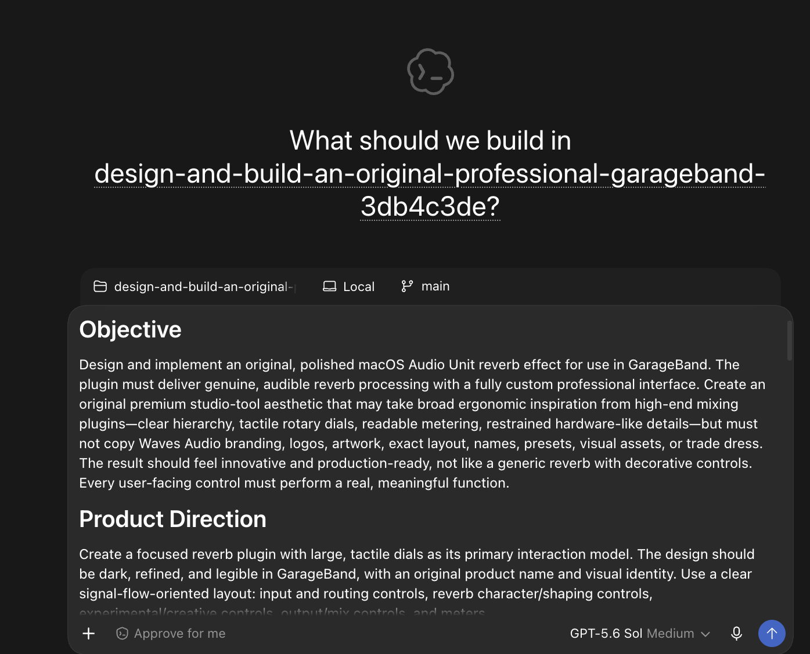

## How the backend works

PromptFoundry is a native Swift application built with SwiftUI, SwiftData, AppKit interoperability where necessary, and macOS Keychain. Its architecture separates presentation, prompt refinement, Codex integration, persistence, model configuration, import/export, and error handling so that the interface is not responsible for backend behavior.

The backend is designed around two distinct responsibilities: privately refining a rough idea and deliberately handing the reviewed result to Codex. Keeping those responsibilities separate makes it possible to use conservative permissions during refinement while still giving users explicit control over a later execution task.

### Local Codex refinement

By default, refinement uses the user’s signed-in local Codex installation rather than asking for a separately embedded API key. PromptFoundry starts a private, ephemeral refinement thread through Codex app-server with:

- a read-only sandbox;
- approval requests disabled for refinement;
- instructions forbidding tool calls, file inspection, commands, and modifications;
- a structured response contract for the professional prompt, title, task type, additions, assumptions, missing information, questions, and risk flags.

The structured response is validated before it updates the interface. If parsing fails, the raw response is retained and one safe recovery is attempted rather than discarding the user’s original idea.

Using an ephemeral refinement thread means prompt development does not need to create a visible long-lived Codex task every time the user generates or reshapes text. The refiner is instructed to return structured content only; it is not authorized to explore the Mac, modify a project, or treat prompt generation as permission to execute the requested work.

### Codex handoff

For the desktop handoff, PromptFoundry carries the complete prompt and reviewed directory into Codex Desktop’s new-chat route. Codex Desktop then creates and owns the resulting chat. This is important: it avoids leaving the chat locked to a second background app-server process.

The separate **Create Codex Task** path supports reviewed task creation with the selected model, reasoning, working directory, sandbox, and approval policy. A desktop-created chat uses the execution settings currently selected inside Codex.

Connection and app-server errors are reported while the generated prompt remains recoverable. Desktop URL handoff reports dispatch to macOS; the user confirms the resulting draft in Codex. It does not provide a destination-side acknowledgment.

### Local-first data handling

Prompt work can contain unpublished product ideas, client context, research questions, or internal project details. PromptFoundry therefore treats local storage and credential handling as product behavior rather than an afterthought.

- Prompt history and versions are stored locally with SwiftData.
- Meaningful edits can be saved automatically.
- Search covers titles, original ideas, professional prompts, and tags.
- Libraries can be exported, backed up, imported, and restored.
- Optional API credentials are stored in macOS Keychain with device-only accessibility—not in source, UserDefaults, SwiftData, logs, or exports.
- Complete user prompts are not logged by default.
- There are no PromptFoundry accounts, analytics, advertising, or cloud synchronization in V1 or V2. Refinement still uses the selected external AI provider.

Local-first does not mean locked in: users can export individual prompts or back up and restore the wider library. Exported prompt content is user-controlled, while sensitive Keychain material and security-scoped bookmarks are excluded from library exports.

## Settings

PromptFoundry’s native Settings window is organized into focused areas. Defaults reduce repetitive setup, but the important choices remain available in the workspace and handoff review whenever a particular task needs different treatment.

### General

General settings control how PromptFoundry fits into everyday Mac use. V2 uses the dark editorial theme, automatic saving protects meaningful edits, and history tools make it possible to move or restore the local library deliberately.

- Default target.
- Automatic saving for meaningful edits.
- Fixed dark editorial appearance in V2.
- Local database location.
- Library export, import, and strongly confirmed deletion.

### Models

Refinement and execution are separate jobs, so they have separate defaults. A fast refiner may be appropriate for a simple rewrite, while a demanding implementation may justify a stronger Codex execution model. Friendly tiers make the choice understandable, while the underlying model identifier remains visible for users who want precision.

- Default refinement model and reasoning effort.
- Default Codex execution model and reasoning effort.
- Friendly Fast, Balanced, and Deep choices with underlying model identifiers.
- Graceful handling when a model or reasoning level is unavailable.

### Privacy

The default local Codex provider avoids requiring a separately pasted API key when the user is already signed in to Codex. If the optional API route is selected, its credential lifecycle is explicit: save in Keychain, check status, and delete securely from the settings interface.

- Refinement provider selection: signed-in local Codex by default or an optional OpenAI API configuration.
- Keychain-backed credential storage and deletion.
- Clear local-storage behavior.

### Codex

Codex settings define the normal destination for implementation work. An automatic project directory prevents the user from being interrupted by a folder picker at handoff time, while connection status and approval behavior remain visible rather than being assumed.

- Default project directory.
- Automatic creation of a managed project folder when needed.
- Codex connection status.
- Default approval behavior.

### Shortcuts

The keyboard shortcuts cover the complete core workflow—from a new rough idea to generation, saving, copying, search, and Codex handoff. They are mirrored by visible controls, so keyboard efficiency does not come at the cost of discoverability.

- `⌘N` — New Prompt
- `⌘↩` — Generate Professional Prompt
- `⇧⌘↩` — Run in Codex
- `⌘S` — Save
- `⇧⌘C` — Copy Professional Prompt
- `⌘,` — Settings
- `Esc` — stop generation or dismiss the active sheet

## History and reusable work

Each saved prompt can retain the original idea, professional prompt, context, target, task type, depth, models, reasoning, sandbox choice, assumptions, additions, missing information, questions, risks, tags, favorite status, dates, attachments, and previous versions.

The library panel supports search, complete workspace recall, favorites, recently used items, sorting, duplication, rename, export, and deletion. Recent prompt shortcuts also appear above the two editors. This turns prompt preparation from a disposable chat step into a reusable professional library.

Complete recall matters because the professional prompt alone is not the whole decision record. Reopening an item also restores the rough idea and the settings that shaped it, making it easier to understand why a prompt looks the way it does. Version preservation lets users experiment with a shorter or deeper result without silently destroying an earlier draft that may still be valuable.

## Example shown here

The V2 screenshots show a local macOS reading-list app brief. A rough idea is expanded into requirements, scope boundaries, persistence, export behavior and verification. The clarification and comparison captures show how to review and refine that starting brief.

The original V1 screenshots below are retained as a historical GarageBand example. The rough idea communicates the desired product, reverb focus, visual ambition, dials, presets, and broad professional inspiration—but it does not spell out many engineering and delivery details that determine whether the result will be credible.

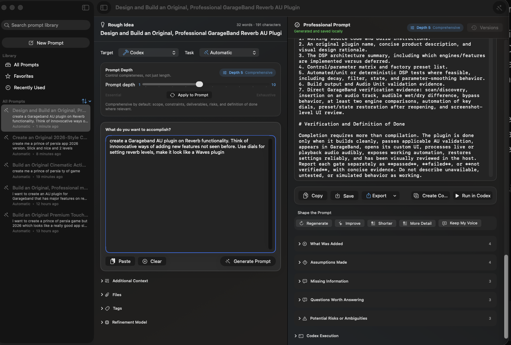

At default depth 5, PromptFoundry expands that idea into a 979-word implementation brief covering distinct reverb modes, genuine DSP behavior, real-time audio constraints, interface expectations, originality boundaries, scope, testing, Audio Unit validation, direct GarageBand verification, and a definition of done. It also makes clear that controls must be functional and that compilation alone is not evidence of a finished plugin.

That example illustrates the central product idea: preserve the creative request while supplying enough structure for another AI system to execute it responsibly. The user can still edit or reject any addition, but they no longer have to remember every specialist concern before writing the first sentence.

## Project status

PromptFoundry V2 2.0.0 is the current unsigned, unnotarized Apple Silicon DMG in [GitHub Releases](https://github.com/swihpi/PromptFoundry/releases). The original V1 1.0.0 installer remains downloadable. This repository publishes the V2 source, verification utilities, Codex integration probe, packaging scripts, installation notes, changelog and selected screenshots.

V2 was built and checked during implementation, including the existing verification suite, focused workflow checks, live Codex refinement, and installed-interface review. The aligned-editor update and this publication pass did not rerun application tests. Release packaging is checked separately. Desktop dispatch was accepted by macOS, but visual confirmation inside Codex was unavailable because computer access to that app was blocked. See [CHANGELOG.md](CHANGELOG.md) for the release boundaries.

## Build from source

The package targets Apple Silicon Macs running macOS 14 or later. A current Apple Swift toolchain with SwiftUI and SwiftData support is required. The manifest uses the toolchain's normal macro discovery when available; a custom SwiftData macro library can be supplied with the `PROMPTFOUNDRY_SWIFTDATA_PLUGIN` environment variable when a command-line-only setup needs it.

```bash
git clone https://github.com/swihpi/PromptFoundry.git
cd PromptFoundry
./script/build_and_run.sh --build-only
```

The staged app is written to `dist/PromptFoundry-V2.app`. To build the same unsigned DMG layout used for the public release:

```bash
./script/build_dmg.sh
```

The build scripts use an ad-hoc signature only. They do not require or reference an Apple Developer account, certificate, provisioning profile, personal username, API credential, or Codex token. PromptFoundry discovers Codex on first launch and keeps the selected executable and projects-folder preferences on the local Mac.

## Independence and trademarks

PromptFoundry is an independent project and is not affiliated with, endorsed by, or sponsored by OpenAI or Apple. Codex, ChatGPT, macOS, SwiftUI, SwiftData, Keychain, GarageBand, and Audio Unit are trademarks or product names of their respective owners. Product names are used only to explain interoperability and the documented example; references to other professional tools describe broad usability inspiration, not copied branding, artwork, layouts, assets, or trade dress.
