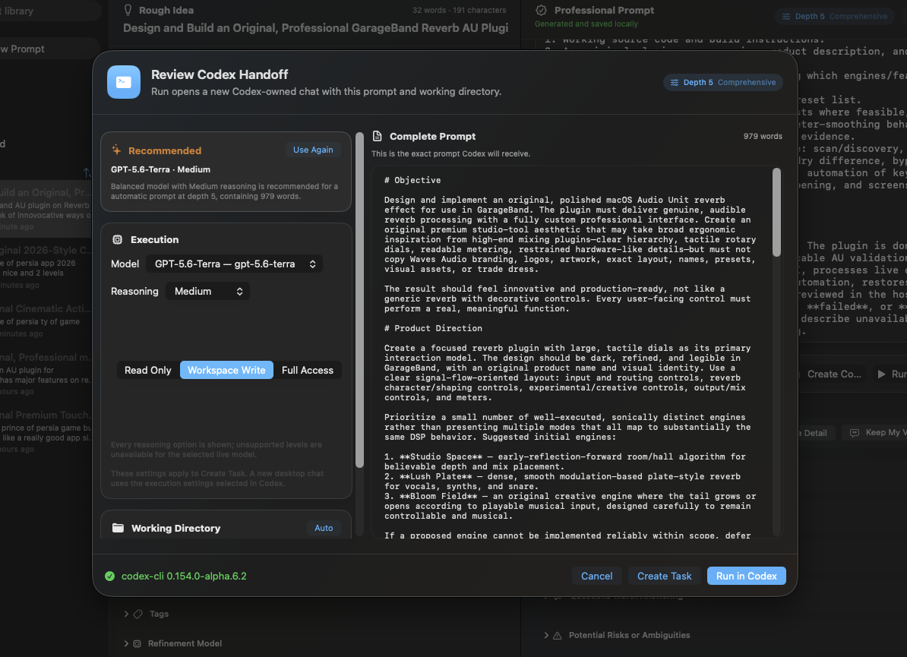

# PromptFoundry

**Turn a rough idea into a complete, professional prompt—and carry it into Codex without rebuilding the brief by hand.**

PromptFoundry is a native macOS prompt-development workspace for people who know what they want to accomplish but do not want to spend their time manually assembling a long prompt-engineering template. It preserves the user’s intent, adds only useful execution structure, exposes assumptions and missing information, and keeps the finished prompt editable.

> This is an informational showcase repository. It intentionally contains **no application source code, binaries, credentials, user data, or private prompt library**.

## Why PromptFoundry exists

A short request can communicate the idea while still leaving an AI system to infer the scope, constraints, deliverables, risks, test strategy, and definition of done. Adding those details manually is repetitive, and pasting a generic “mega-template” around every idea often makes prompts longer without making them better.

PromptFoundry treats prompt development as an editable workflow:

1. Write naturally in the **Rough Idea** editor.
2. Choose the target and task type—or let the app infer the task type.
3. Set **Prompt Depth** from 1 to 10.
4. Generate a structured professional prompt with a signed-in local Codex account by default.
5. Review additions, assumptions, missing information, questions, and risks.
6. Edit, reshape, save, export, or open the complete prompt in a new Codex chat.

The result is not merely a longer version of the input. The goal is a clearer execution contract: the intended outcome, relevant constraints, expected deliverables, scope boundaries, verification steps, and honest uncertainty are made explicit where they matter.

## What it improves over the manual approach

| Manual prompt preparation | PromptFoundry workflow |
| --- | --- |
| Remember and retype a preferred prompt structure | Applies task-aware structure consistently |
| Important gaps remain hidden inside the final prose | Separates assumptions, missing information, questions, and risks |
| Generic templates add irrelevant boilerplate | Adapts to coding, research, writing, troubleshooting, and other work |
| Revisions overwrite useful earlier wording | Maintains local prompt history and versions |
| Copy, switch apps, choose a folder, and rebuild settings | Reviews the handoff and carries the prompt plus working directory into Codex |
| Prompt length is difficult to calibrate | A 1–10 depth control makes completeness deliberate |

### Benefits of a professional prompt

- Less ambiguity before work begins.
- Better alignment between the requested outcome and delivered result.
- Fewer unnecessary clarification loops.
- Clearer scope boundaries and non-goals.
- More useful acceptance criteria and verification evidence.
- Explicit treatment of destructive, expensive, external, or irreversible actions.
- A reusable brief that can be edited, versioned, searched, and exported.
- More consistent results across repeated professional workflows.

## The Rough Idea side

The left workspace is deliberately approachable: users can begin with ordinary language instead of learning prompt-engineering syntax.

- **Target** — Codex, ChatGPT, General AI, Writing, Research, Coding, Troubleshooting, or a custom destination.
- **Task type** — select a category or use Automatic so the refiner can adapt the structure.
- **Prompt Depth** — controls completeness from 1 (essential) to 10 (exhaustive), with 5 as the comprehensive default.
- **Rough Idea editor** — a large multiline editor with word and character counts.
- **Additional Context** — optional background, constraints, audience, environment, or desired tone.
- **Files** — references relevant local files without turning their paths into shell commands.
- **Tags** — organizes prompts for later search and reuse.
- **Refinement Model** — friendly Fast, Balanced, and Deep tiers plus the underlying model and supported reasoning effort.
- **Paste, Clear, and Generate Prompt** — focused controls with keyboard-friendly behavior.

### Prompt Depth, explained

Prompt Depth controls **completeness, not padding**:

- **1–2 · Essential** — a compact execution brief containing only the core outcome and necessities.
- **3–4 · Focused** — adds useful structure, requirements, output expectations, and checks.
- **5–6 · Comprehensive** — the default; covers relevant scope, constraints, deliverables, risks, and definition of done.
- **7–8 · Detailed** — adds edge cases, failure handling, compatibility, and stronger verification guidance.
- **9–10 · Exhaustive** — an extensive but non-repetitive specification for complex or high-stakes work.

Changing depth after generation can resize the existing prompt rather than forcing the user to start again.

## The Professional Prompt side

The generated prompt remains a real editor—not a locked preview.

- **Copy, Save, and Export** to Markdown or plain text.
- **Create Codex Task** for an app-server-backed task using the reviewed task settings.
- **Run in Codex** to open a fresh Codex-owned chat with the complete prompt and working directory.
- **Regenerate** when a new complete draft is appropriate.
- **Improve** to strengthen clarity and execution detail.
- **Shorter** to reduce length without losing the essential contract.
- **More Detail** to expand relevant implementation and verification guidance.
- **Keep My Voice** to protect important wording and tone.
- **Versions** to revisit earlier useful results.
- Expandable sections for **What Was Added**, **Assumptions Made**, **Missing Information**, **Questions Worth Answering**, and **Potential Risks or Ambiguities**.
- **Codex Execution** controls for model, reasoning effort, and Read Only, Workspace Write, or Full Access file permissions where supported.

## Review before Codex

PromptFoundry shows a dedicated handoff review rather than silently running a prompt against an arbitrary directory. The review presents the complete, scrollable prompt alongside the recommended model, reasoning effort, file access, and automatically selected working directory.

The working-directory field is intentionally kept outside the published frame so no personal local path is exposed.

## From PromptFoundry to Codex

The final handoff opens the professional prompt in a new Codex chat. Codex Desktop owns that chat, which avoids cross-application task ownership conflicts. The Codex sidebar is intentionally excluded from the screenshot below.

## How the backend works

PromptFoundry is a native Swift application built with SwiftUI, SwiftData, AppKit interoperability where necessary, and macOS Keychain.

### Local Codex refinement

By default, refinement uses the user’s signed-in local Codex installation rather than asking for a separately embedded API key. PromptFoundry starts a private, ephemeral refinement thread through Codex app-server with:

- a read-only sandbox;
- approval requests disabled for refinement;
- instructions forbidding tool calls, file inspection, commands, and modifications;
- a structured response contract for the professional prompt, title, task type, additions, assumptions, missing information, questions, and risk flags.

The structured response is validated before it updates the interface. If parsing fails, the raw response is retained and one safe recovery is attempted rather than discarding the user’s original idea.

### Codex handoff

For the desktop handoff, PromptFoundry carries the complete prompt and reviewed directory into Codex Desktop’s new-chat route. Codex Desktop then creates and owns the resulting chat. This is important: it avoids leaving the chat locked to a second background app-server process.

The separate **Create Codex Task** path supports reviewed task creation with the selected model, reasoning, working directory, sandbox, and approval policy. A desktop-created chat uses the execution settings currently selected inside Codex.

### Local-first data handling

- Prompt history and versions are stored locally with SwiftData.
- Meaningful edits can be saved automatically.
- Search covers titles, original ideas, professional prompts, and tags.
- Libraries can be exported, backed up, imported, and restored.
- Optional API credentials are stored in macOS Keychain with device-only accessibility—not in source, UserDefaults, SwiftData, logs, or exports.
- Complete user prompts are not logged by default.
- There are no accounts, analytics, advertising, or cloud synchronization in the first version.

## Settings

PromptFoundry’s native Settings window is organized into focused areas:

### General

- Default target.
- Automatic saving for meaningful edits.
- System, Light, or Dark appearance.
- Local database location.
- Library export, import, and strongly confirmed deletion.

### Models

- Default refinement model and reasoning effort.
- Default Codex execution model and reasoning effort.
- Friendly Fast, Balanced, and Deep choices with underlying model identifiers.
- Graceful handling when a model or reasoning level is unavailable.

### Privacy

- Refinement provider selection: signed-in local Codex by default or an optional OpenAI API configuration.
- Keychain-backed credential storage and deletion.
- Clear local-storage behavior.

### Codex

- Default project directory.
- Automatic creation of a managed project folder when needed.
- Codex connection status.
- Default approval behavior.

### Shortcuts

- `⌘N` — New Prompt
- `⌘↩` — Generate Professional Prompt
- `⇧⌘↩` — Run in Codex
- `⌘S` — Save
- `⇧⌘C` — Copy Professional Prompt
- `⌘F` — Search History
- `⌘,` — Settings
- `Esc` — stop generation or dismiss the active sheet

## History and reusable work

Each saved prompt can retain the original idea, professional prompt, context, target, task type, depth, models, reasoning, sandbox choice, assumptions, additions, missing information, questions, risks, tags, favorite status, dates, attachments, and previous versions.

The history sidebar supports search, complete workspace recall, favorites, recently used items, sorting, duplication, rename, export, and deletion. This turns prompt preparation from a disposable chat step into a reusable professional library.

## Example shown here

The screenshots demonstrate a brief request for an original macOS Audio Unit reverb plugin for GarageBand. At default depth 5, PromptFoundry expands the rough request into a 979-word implementation brief covering distinct reverb modes, genuine DSP behavior, interface expectations, scope boundaries, testing, Audio Unit validation, GarageBand verification, and a definition of done.

That example illustrates the central product idea: preserve the creative request while supplying enough structure for another AI system to execute it responsibly.

## Project status

PromptFoundry is currently presented here as an informational product showcase. This repository is not a source distribution and does not provide an installer or public release artifact.

## Independence and trademarks

PromptFoundry is an independent project and is not affiliated with, endorsed by, or sponsored by OpenAI or Apple. Codex, ChatGPT, macOS, SwiftUI, SwiftData, Keychain, GarageBand, and Audio Unit are trademarks or product names of their respective owners. Product names are used only to explain interoperability and the documented example.
